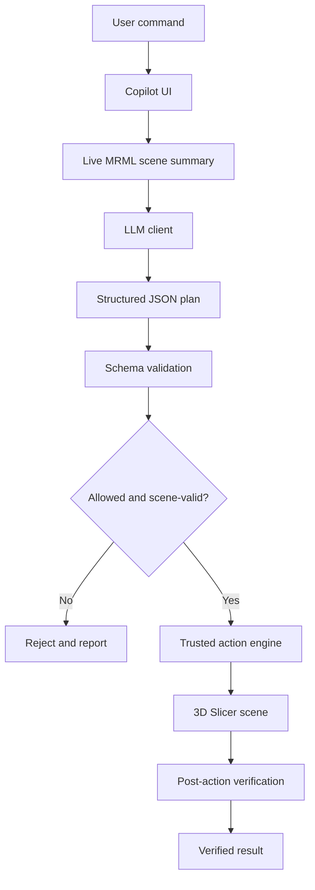

from pathlib import Path

readme = r'''<div align="center">

# 🧠 Slicer AI Copilot

### Scene-aware AI assistance for 3D Slicer

**Natural language in. Validated actions out. Verified results.**

<p align="center">
  
</p>

[](https://www.slicer.org/)
[](https://www.python.org/)
[](tests/)
[](LICENSE)

[Features](#-features) · [Quick Start](#-quick-start) · [Architecture](#-architecture) · [Safety](#-safety-and-privacy) · [Roadmap](#-roadmap)

**Created by [Juhaim Mohammed MT](https://github.com/Juhamim)**

</div>

---

## 💡 Overview

**Slicer AI Copilot** is a scripted module for [3D Slicer](https://www.slicer.org/) that translates plain-English requests into controlled visualization operations on the current medical-imaging scene.

Instead of navigating multiple panels to adjust objects, display properties, and camera views, users can describe the result they want:

- “Show only the tumor and the surrounding vessels.”
- “Make the liver 30% opaque.”
- “Zoom to the tumor and switch to 3D.”
- “Show the axial view.”
- “Which structures are currently visible?”

The copilot reads the live scene, asks an LLM for a structured action plan, validates that plan, executes approved operations through trusted Python code, and checks the resulting scene state.

> **Research and education prototype only.** Slicer AI Copilot is not a medical device and must not be used for diagnosis, treatment selection, or clinical decision-making.

## ✨ Features

<table>
<tr>
<td width="50%" valign="top">

### 💬 Natural-language control
Describe common visualization tasks in plain English.

### 🧠 Live scene awareness
Reads the current MRML scene on each request and grounds targets in loaded objects.

### 🛡️ Structured action plans
The model returns JSON action plans rather than executable Python code.

</td>
<td width="50%" valign="top">

### ✅ Result verification
Re-reads scene state after execution and reports action outcomes.

### 🎨 Visualization controls
Supports visibility, opacity, RGB color, display reset, camera reset, zoom-to-object, and layout switching.

### 📂 Case-file workflow
Detects supported imaging and mesh files and lets users review selections before importing.

</td>
</tr>
<tr>
<td colspan="2" valign="top">

### 🔌 Flexible LLM providers
OpenAI-compatible client with presets for ModelScope, Gemini, and OpenAI, plus configurable endpoints and model identifiers.

</td>
</tr>
</table>

## 🚀 Quick Start

### Requirements

- 3D Slicer 5.x recommended
- An API key from a supported OpenAI-compatible LLM provider
- Git

Slicer AI Copilot uses the Python environment bundled with 3D Slicer for in-app operations.

### 1. Clone the repository

```bash
git clone https://github.com/Juhamim/Autoslicer.git
cd Autoslicer
```

### 2. Add the module to 3D Slicer

In Slicer, open **Edit → Application Settings → Modules**. Under **Additional module paths**, add the `SlicerAICopilot/` folder containing `SlicerAICopilot.py`, apply the setting, and restart Slicer.

### 3. Open the module

Navigate to **Modules → Utilities → Slicer AI Copilot**.

### 4. Configure an LLM provider

Open **Settings** in the copilot panel, select a provider, enter your API key, and save.

Alternatively, set environment variables before launching Slicer:

```bash
LLM_PROVIDER=gemini
LLM_API_KEY=your-api-key
LLM_MODEL=gemini-2.5-flash
```

Available configuration variables:

| Variable | Purpose |
|---|---|
| `LLM_PROVIDER` | Provider preset: `modelscope`, `gemini`, or `openai` |
| `LLM_API_KEY` | API credential |
| `LLM_BASE_URL` | Optional endpoint override |
| `LLM_MODEL` | Optional model identifier override |

Provider presets:

| Provider | Default endpoint | Default model |
|---|---|---|
| ModelScope | `https://api-inference.modelscope.ai/v1` | `Qwen/Qwen3.5-9B` |
| Gemini | `https://generativelanguage.googleapis.com/v1beta/openai` | `gemini-2.5-flash` |
| OpenAI | `https://api.openai.com/v1` | `gpt-4o` |

Model availability may vary by account and region. Keep API keys private and never commit them to Git.

### 5. Import a case and start prompting

Drop a case folder into the panel, review detected files, select the data to import, and choose **Import Case**. Then enter a natural-language command.

## 💬 Example Commands

### Visibility

```text
Show the tumor
Hide the skin
Show only the tumor and vessels
Hide everything except the tumor
```

### Display

```text
Make the liver transparent
Set tumor opacity to 80%
Make the tumor red
Reset the liver display
```

### Navigation

```text
Zoom to the tumor
Center on the liver
Reset the view
Show the axial view
Switch to the sagittal view
Show me 3D
```

### Scene queries

```text
What is loaded?
What structures are currently visible?
List all objects
```

### Supported file formats

- **Medical imaging:** DICOM, NIfTI, NRRD
- **3D models and geometry:** VTK, STL, OBJ, PLY

The file manager detects candidate files and presents selections before import. DICOM files are currently grouped by folder.

## 🏗️ Architecture

The model proposes intent; application code controls execution.



### Core components

| Component | Responsibility |
|---|---|
| `chat_ui.py` | Chat interface, drag-and-drop, settings, and status |
| `llm_client.py` | OpenAI-compatible LLM communication |
| `scene_manager.py` | MRML scene inspection and node lookup |
| `schemas.py` | Typed action contracts and allowed action definitions |
| `validator.py` | Action, parameter, and target validation |
| `action_engine.py` | Executes approved Slicer operations |
| `verification.py` | Re-reads scene state and checks outcomes |
| `file_manager.py` | File detection and case import |
| `utils.py` | Matching, file identification, and formatting |

The validator is a security boundary between model output and the action engine. The LLM client does not directly execute scene-changing operations.

## 🛡️ Safety and Privacy

- **No arbitrary model-generated Python execution:** model output is parsed as structured JSON.
- **Allowlisted actions:** unknown action types are rejected.
- **Typed parameters:** opacity and RGB color values are constrained to valid ranges.
- **Scene-grounded targets:** requested nodes must resolve to objects in the current scene.
- **Post-action verification:** reported outcomes are checked against the resulting scene state.
- **No destructive verbs in the current action set:** actions such as `DELETE`, `CLEAR_SCENE`, `SAVE`, and `EXPORT` are not part of the defined action set.
- **Fail-closed behavior:** parsing, validation, or execution errors are surfaced instead of silently treated as success.

### Data handling

The scene summary sent to the LLM contains metadata such as node names, types, visibility, opacity, and color. The documented scene-summary flow does not send image pixels, voxel data, DICOM tags, or patient identifiers. Node names and other metadata can still be sensitive. Review applicable institutional privacy and data-sharing policies before using third-party AI services with real patient cases.

API credentials saved through in-app settings are stored in `~/.slicer_ai_copilot/settings.json` in plaintext. Protect this file on shared systems; environment variables may be preferable on shared or clinical workstations.

## 🧪 Testing

The repository includes a unit-test suite designed to run under regular CPython with Slicer dependencies mocked.

```bash
pip install -r requirements.txt
python -m pytest tests/ -v
```

The project currently documents **101 passing tests**. Run the suite on your checkout to confirm its current status.

| Test module | Coverage |
|---|---|
| `test_validator.py` | Allowlist, parameter bounds, target validation |
| `test_action_engine.py` | Action execution and failure handling |
| `test_scene_manager.py` | Node enumeration and scene state |
| `test_verification.py` | Post-execution assertions |
| `test_file_manager.py` | File detection and DICOM grouping |
| `test_llm_client.py` | Provider configuration and response parsing |

## 🗂️ Project Structure

```text
Autoslicer/
├── SlicerAICopilot/
│   ├── SlicerAICopilot.py
│   └── SlicerAICopilotLib/
│       ├── chat_ui.py
│       ├── llm_client.py
│       ├── scene_manager.py
│       ├── action_engine.py
│       ├── validator.py
│       ├── verification.py
│       ├── file_manager.py
│       ├── schemas.py
│       ├── utils.py
│       └── Resources/
├── prompts/
├── knowledge/
├── tests/
├── docs/
├── .env.example
├── Agents.md
├── LICENSE
└── README.md
```

## 🧑‍💻 Developer API

The library exposes accessors for using core components independently of the UI.

```python
import sys
sys.path.insert(0, "<path>/Autoslicer/SlicerAICopilot")

from SlicerAICopilotLib import (
    get_scene_manager,
    get_validator,
    get_action_engine,
    get_verifier,
    get_llm_client,
)

scene = get_scene_manager()
print(scene.get_scene_summary().model_dump())

client = get_llm_client()
print(client.is_available(), client.provider, client.model)
```

### Validate, execute, and verify

```python
from SlicerAICopilotLib import ActionPlan
from SlicerAICopilotLib import (
    get_validator,
    get_action_engine,
    get_verifier,
)

plan = ActionPlan.model_validate({
    "version": "1.0",
    "reply": "Hiding skin.",
    "actions": [{"type": "HIDE", "target": "Skin"}],
})

valid, errors = get_validator().validate_plan(plan)

if valid:
    results = get_action_engine().execute_plan(plan)
    verified = get_verifier().verify_plan(plan.actions, results)

    for result in verified:
        print(result.passed, result.message)
```

## 🗺️ Roadmap

- [ ] Move LLM inference off the Qt main thread
- [ ] Support conversational turns with empty action plans
- [ ] Add UI-based target disambiguation
- [ ] Add background streaming responses
- [ ] Add scene-aware conversation memory
- [ ] Add Slicer documentation retrieval behind the validator
- [ ] Group DICOM series by `SeriesInstanceUID`
- [ ] Add an audit log for planning, validation, execution, and verification
- [ ] Expand provider support, including local inference options

## 🤝 Contributing

Contributions, bug reports, and suggestions are welcome. Please read [`Agents.md`](Agents.md) for the project's engineering principles before proposing changes.

For a new action, update the schema, allowlist, validator, action engine, verifier, prompts, knowledge catalogue, and tests. Keep the action set small, explicit, and testable.

## 👨‍💻 Creator

<div align="center">

### Juhaim Mohammed MT

**Engineering Student · Cybersecurity · AI Systems · Full-Stack Development**

Building practical AI-powered systems with a focus on automation, security, and reliable software engineering.

[](https://github.com/Juhamim)
[](https://github.com/Juhamim/Autoslicer)
[](https://github.com/Juhamim/threathunder-production)

</div>

## ⚕️ Medical Disclaimer

Slicer AI Copilot is a **research and education prototype**, not a medical device, and is not FDA-cleared. It must not be used for diagnosis, treatment selection, or clinical decision-making. It does not determine whether a segmentation is anatomically correct or make claims about a patient's condition. All medical interpretation remains the responsibility of qualified professionals.

## 📄 License

This project is distributed under the [MIT License](LICENSE).

---

<div align="center">

**Slicer AI Copilot**  
*Understand the scene. Validate the plan. Verify the result.*

Built for hackathon challenge **N35 — Verified natural-language automation of 3D Slicer**.

[Repository](https://github.com/Juhamim/Autoslicer) · [Issues](https://github.com/Juhamim/Autoslicer/issues)

</div>
'''
path = Path("/mnt/data/README_CLEAN_COPY_PASTE.md")
path.write_text(readme, encoding="utf-8")
print(f"Created clean Markdown README: {path}\nLines: {len(readme.splitlines())}\nCharacters: {len(readme):,}")

